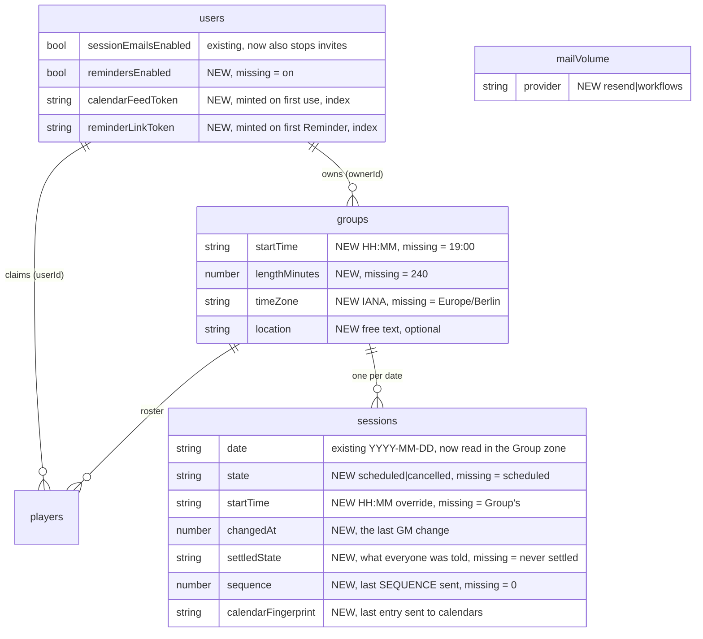
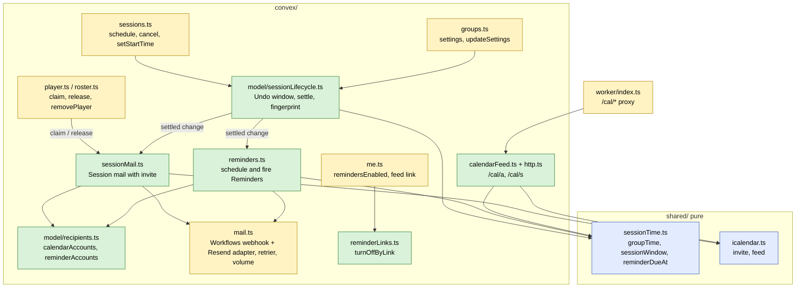
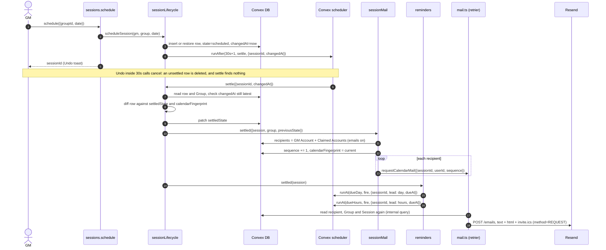
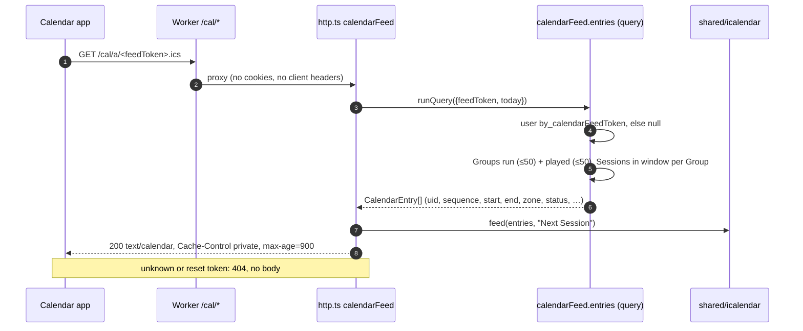
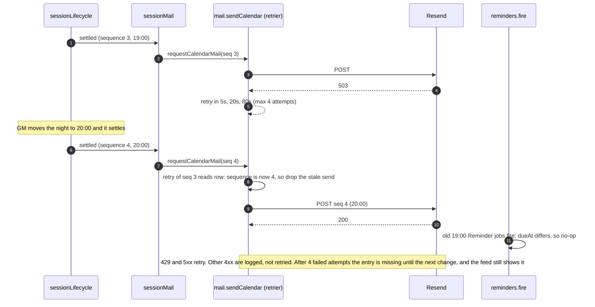
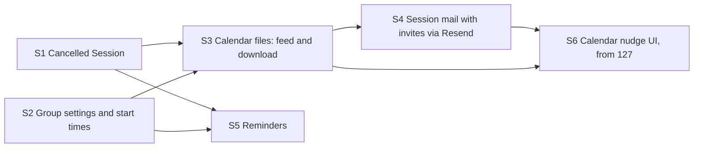

# Calendar sync: architecture

Status: **parked for Michael's review** (prototype [#126](https://github.com/Silthus/next-session/issues/126) on map [#120](https://github.com/Silthus/next-session/issues/120)). Throwaway branch `prototype/calendar-sync-architecture`, never merged. The specs that follow copy from it.

Worked AFK on recommended answers. Every call marked 🤖 is the worker's own recommendation, waiting for Michael's review. Calls marked 🔒 are already settled by a closed ticket, the code or an ADR, and the source is named next to them.

## The question

How should calendar sync be shaped across modules and the data model? It covers the start time model, the Group location, the Cancelled Session, delivery, Reminders, a stable `UID` and `SEQUENCE` per Session, how delivery hooks into `sessions.schedule` / cancel next to the Session mail and its Undo window, the ICS download, the test seams, and the spec split.

## Inputs

| Ticket | What it settled |
| --- | --- |
| [#121](https://github.com/Silthus/next-session/issues/121) | 🔒 Emailed invites (iMIP) are the push path. Beside them, a secret per-Account feed that shares its iCalendar generation with the visitor download. GM Google Calendar dropped |
| [#122](https://github.com/Silthus/next-session/issues/122) | 🔒 Workflows can't attach a `text/calendar` part. Calendar mail goes through Resend from Convex |
| [#123](https://github.com/Silthus/next-session/issues/123) | 🔒 Geoapify Free from the browser over a plain text field. Store only the string |
| [#124](https://github.com/Silthus/next-session/issues/124) | 🔒 A Session is scheduled or cancelled. **Schedule again** restores the same Session. A change inside the Undo window reaches nobody |
| [#125](https://github.com/Silthus/next-session/issues/125) | 🔒 Reminders are emails 1 day and 2 hours before the start, only to Accounts behind Claimed Players, with their own switch (default on) and a footer link. No `VALARM` anywhere. Scheduled in Convex. Workflows can send them |
| [#129](https://github.com/Silthus/next-session/issues/129) | 🔒 `METHOD:REQUEST` with the player as `ATTENDEE` lands, moves and cancels hands-free in Outlook. Gmail at "known sender" needs one tap. RSVP fails |
| Map notes | 🔒 Usual start time, time zone and length on a new Group settings page, and a Session can override its time. One location per Group. RSVP sync and travel time are out. No explicit onboarding |

Code read and checked: `convex/schema.ts:70` (`sessions` is `{groupId, date}`), `convex/sessions.ts:11` (`schedule`), `convex/sessions.ts:34` (`unschedule` hard-deletes), `convex/notifications.ts:212` (`queueSessionMail` and the `sessionMailStates` latest-change row), `convex/notifications.ts:117` (`sessionChanged` waits out the window, then `fanOut`), `convex/mail.ts:98` (`sendSession` posts to the Workflows webhook through the action retrier), `convex/mail.ts:136` (`recordMailVolume`, one counter across kinds), `convex/http.ts` (only Convex Auth routes), `convex/crons.ts` (one daily sweep), `worker/index.ts` (the `/ingest` proxy pattern), `convex/player.ts:228` and `convex/me.ts:100` (Session reads return dates only).

## RSVP live send (follow-up from #129)

One `METHOD:REQUEST` with `ATTENDEE;…;PARTSTAT=ACCEPTED;RSVP=FALSE`, sent 2026-10-16 09:28 Berlin through Resend from `hello@next-session.link`. The script is in [`rsvp-live-send/`](rsvp-live-send/). No key or address is committed.

- **Raw MIME (disposable mail.tm inbox):** the calendar part arrives as `text/calendar; charset=utf-8; method=REQUEST; name=invite.ics`, base64, and decodes to `ATTENDEE;CN=Player;ROLE=REQ-PARTICIPANT;PARTSTAT=ACCEPTED;RSVP=FALSE:mailto:<inbox>` unchanged. DKIM `d=next-session.link`, SES `eu-west-1`, as in #129.
- **Delivery:** Resend accepted all three sends to Michael's test inboxes (3 ids). The key can only send, so delivery is read in the inboxes.
- **Client rendering: Michael's to check.** Look for **"Spieleabend C · RSVP-Test"**, Sat 31.10. 19:00–23:00 Berlin, subject `[RSVP-Test 2026-10-16 accepted]`. Two questions:
  1. Does Notion Calendar (or Outlook / Gmail) still show an RSVP button, and does tapping it still fail?
  2. Does the entry show as "Going" / accepted?

  `bun --env-file ~/.config/next-session/invite-test.env docs/architecture/rsvp-live-send/send.ts accepted-cancel inboxes` removes it afterwards.
- This send still carried the 2-hour `VALARM` from #129's builder, because it went out before #125 dropped alarms. That doesn't change the RSVP result. The script no longer emits one.

---

## Round 1: Context


❓ **Q1.1 Who gets the calendar entry?** The destination says "every Account that runs a Group or keeps one". Session updates today exclude the actor.
➡️ 🤖 **The GM's Account and every Account behind a Claimed Player, the actor included.** A calendar entry is the point, not news, so the GM who scheduled the night gets it too. An Anonymous GM has no email and uses the download. Reminders stay as #125 set them: only Accounts behind Claimed Players.

❓ **Q1.2 Does the invite come on top of the Session update, or replace it?** #122 left this open. Session updates are live in Workflows (#102).
➡️ 🤖 **Replace it: one Session mail per change and Account, sent through Resend, with the Session update text as the body and the invite as its calendar part.** Two mails per change is noise, and an invite already carries a body. It also splits the two 100-a-day quotas by job: Resend carries Session mail, Workflows carries Welcome, Tips and Reminders (the largest volume, 2 per Session and Account). This reopens the ADR-0011 amendment of 2026-10-07 and needs a new ADR (see Capture). *Alternative:* keep the Workflows update and add a separate invite mail. That keeps #102's live path untouched but sends two mails for every set and cancel.

❓ **Q1.3 One sender, or one per Group?** Google advises against a generic sender (#121).
➡️ 🤖 **One sender, `Next Session <calendar@next-session.link>`, which is also the `ORGANIZER`.** #129 proved the shared sender works in Outlook. Per-Group senders cost DNS and reputation work for a hypothetical gain. `hello@` stays for Welcome Mail and Tips.

❓ **Q1.4 What happens to RSVP replies?**
➡️ 🤖 **`PARTSTAT=ACCEPTED;RSVP=FALSE` on the attendee, plus a Cloudflare Email Routing rule for `calendar@` that drops mail.** The entry arrives as accepted. Any reply a client still sends is accepted and dropped instead of bouncing, so no personal data is kept and the Privacy Policy needs no row for it. The live send above checks the first half on the wire. Client rendering waits for Michael.

❓ **Q1.5 Gmail's one tap.**
➡️ 🤖 **Absorb it with copy and the feed, not with a contacts trick.** The Session mail says "Not in your calendar yet? Tap **Add to calendar** once." My groups offers **Subscribe in your calendar app** (the Account feed), which is hands-free after one setup. The contacts entry is untested and needs the player to do more than one tap.

---

## Round 2: Data model



Removed: the `sessionMailStates` table. The Session row now keeps its own latest change, because cancelling no longer deletes it.

❓ **Q2.1 Where do the start time, length and time zone live, and what about existing Groups?**
➡️ 🤖 **Four optional fields on `groups`, read through one pure `groupTime(group)` that fills the defaults: 19:00, 4 hours, `Europe/Berlin`.** Existing rows need no migration write: a missing value is the default, as #124 did for the Session state. New Groups capture the creator's browser zone (`Intl.DateTimeFormat().resolvedOptions().timeZone`), passed to `groups.create` and to the anonymous sign-in that creates the first Group, and validated on the server. A GM whose existing Group isn't in Berlin changes it once on the settings page. The 4 hours match the live test. 19:00 is the usual game night start and is easy to change.

❓ **Q2.2 What can a Session override?**
➡️ 🤖 **Its start time only (`sessions.startTime`), with "follow the Group" as the missing value.** The length and location stay the Group's. Michael asked for the time, and one override keeps the day panel to one field. A restored Session keeps its override, because it is the same row. Without an override it follows the Group's current usual time (#124 follow-up).

❓ **Q2.3 How does the Cancelled Session sit in the schema?**
➡️ 🤖 **`state` on the row, missing = scheduled, plus `changedAt` and `settledState`.**
- **Cancel** inside the Undo window of a Session that never settled deletes the row, so it leaves no trace (#124). A cancel inside the window of a **Schedule again** reverts to `cancelled` silently. Any other cancel sets `state: "cancelled"`.
- **Undo of a cancel** and **Schedule again** are the same call, `sessions.schedule({groupId, date})`. It restores the cancelled row by id, or inserts a new one when the row was deleted. A deleted row was never sent anywhere, so a new id loses no calendar identity (#124 follow-up "Undo on a restored id").
- **Migration:** one internal mutation sets `settledState: "scheduled"` on every existing row (a few hundred at most, in one pass of pages). That is the only backfill. It runs before the code that reads `settledState` deploys, in the same PR, through `convex deploy` plus a one-off `convex run`.

❓ **Q2.4 The Group location.**
➡️ 🔒 (#123, map notes) **One optional free-text `groups.location`, at most 200 characters, trimmed.** No coordinates and no provider id. It goes into `LOCATION` and the Reminder.

❓ **Q2.5 Feed and Reminder-link tokens.**
➡️ 🤖 **Two random 128-bit tokens on `users`, each with its own index, minted lazily.** They are credentials in the sense of ADR-0004: whoever holds one gets exactly one thing, the feed or the Reminders switch. They are separate, so a leaked feed URL can't turn off Reminders and the other way round. **Reset feed link** on My groups mints a new feed token at once, with no Undo: a leaked feed wants a hard stop. A stored token, not an HMAC: one lookup, testable without a secret, revocable per Account.

---

## Round 3: Modules and seams



The deep module is **`model/sessionLifecycle.ts`**. Every change to what a Session means to the outside goes through it: schedule, cancel, restore, a time override, a Group settings edit. It owns the Undo window and the settled state. Callers say what changed. The lifecycle decides whether anyone hears about it, and when. Session mail and Reminders are the two channels it hands a settled change to. Each derives what to send from the row, not from the event, so a late, repeated or stale job sends nothing wrong.

❓ **Q3.1 Edge-triggered or level-triggered delivery?** Today `queueSessionMail` records an event (scheduled / cancelled) keyed by Group and date and checks after the window that it still holds.
➡️ 🤖 **Level-triggered.** The settle job runs `UNDO_WINDOW_MS` after the latest `changedAt` (latest wins, so edits coalesce). It compares the row with what was last sent (`settledState`, `calendarFingerprint`) and sends only the difference. That makes "a change inside the Undo window reaches nobody" fall out of the comparison instead of being a special case, and it handles a time edit, a Group settings edit, a rename and a Share Token rotation the same way. The settle job runs whether or not mail is configured, so `settledState` means "past the Undo window" in every deployment, dev and CI included.

❓ **Q3.2 Which fields make the calendar fingerprint?**
➡️ 🤖 **State, start and end instant, time zone, location, the Group name (`SUMMARY`) and the link (`URL`).** Any difference sends a `REQUEST` (or `CANCEL`) with a higher `SEQUENCE`. A Share Token rotation therefore updates every upcoming entry with the new link, which is what a rotation is for. A Group's settings edit fans out to each upcoming Session that follows the Group's time, and each Session settles on its own.

❓ **Q3.3 UID and SEQUENCE.**
➡️ 🤖 **`UID` = `<sessionId>@next-session.link`, fixed for the row's life. `SEQUENCE` = `sessions.sequence`, incremented once per send round for that Session: one broadcast after a settle, or one per-recipient send.** Restoring the same row keeps the same entry (#124). A per-recipient send (a new claim, a release) also bumps it. The others then hold a lower number, which is harmless: a sequence only has to grow per recipient. The feed and the download report the current `sequence`, so a client that holds both never sees the feed go backwards. `DTSTAMP` is the send time. A Convex id reveals nothing, and `ownedSession` already refuses foreign ids.

❓ **Q3.4 Who follows Roster changes?**
➡️ 🤖 **Session mail does.**
- A new claim sends that Account a `REQUEST` for each upcoming scheduled Session of the Group.
- A release, **Remove from my groups**, or the GM removing a Claimed Player sends a `CANCEL` for each upcoming announced Session.
- Deleting a Group (by hand or by Expiry) snapshots its recipients and upcoming announced Sessions before the rows go, and sends `CANCEL`s.

Without this, a player who keeps the Group after the night is set never gets it, and a removed player keeps a ghost entry. Reminders need nothing extra: they resolve recipients when they fire (#125 decision 9).

❓ **Q3.5 How are Reminders scheduled?**
➡️ 🤖 **Two scheduled functions per settled scheduled Session (`day`, `hours`), each carrying its due time.** When one fires, it recomputes the due time from the current row and Group. If the Session is cancelled or gone, or the due time differs (it was moved), it does nothing. If the time passed more than 10 minutes ago, it skips (#125 decision 3). So a move, cancel or Schedule again never has to find and cancel old jobs: settle simply schedules the new pair, and the stale pair no-ops. Recipients are resolved at fire time: Accounts behind Claimed Players with `remindersEnabled !== false`. A due time that has already passed when the Session settles is never scheduled. No cron.

❓ **Q3.6 Where do the feed and the download come from?**
➡️ 🤖 **Convex HTTP actions behind the Worker, on `next-session.link/cal/…`:**
- `GET /cal/a/<feedToken>.ics` is the Account feed: every Session of the Groups the Account runs or plays in, from 31 days back to the end of the Booking Window, cancelled ones as `STATUS:CANCELLED`.
- `GET /cal/s/<shareToken>.ics` is the Group download for visitors: the same window for one Group.

Both use `icalendar.feed` and the same `UID`s and `SEQUENCE`s as the invites. Neither has an `ATTENDEE`, a `METHOD` or a `VALARM`. The Share-Token URL also works as a `webcal://` subscription, and rotating the Share Token stops it, as ADR-0004 wants. The Worker proxies `/cal/` the way it proxies `/ingest/`, so the URL stays on our domain and Convex's host can change. The responses send `Cache-Control: private, max-age=900`. Unknown tokens get a plain 404.

❓ **Q3.7 Where does the Reminders footer link go?**
➡️ 🤖 **`next-session.link/reminders/off?t=<reminderLinkToken>`, a page with one button, "Turn off Reminders".** The button calls `reminderLinks.turnOff({token})`. Opening the link alone changes nothing, so mail scanners can't turn Reminders off (the reason Tips confirm on a button, ADR-0011). The page then offers "Turn them back on" (Undo) and links to My groups. The Session mail footer keeps linking to the authenticated My groups switch (#102).

---

## Round 4: Call paths

### Main write: the GM schedules a night, and it settles



Each participant knows only its own part:
- `sessions.schedule` knows authorization and the Booking Window.
- The lifecycle knows the window and the diff.
- Session mail knows recipients and `SEQUENCE`.
- `mail.ts` knows transports, retries and volume.

The action reads the recipient again at send time, as `sendSession` does today, so a release or opt-out after the fan-out still stops the mail.

### Main read: a calendar app polls the Account feed



Bounded: 100 Groups × at most about 120 dates in the window. Real Groups hold a handful of Sessions. The query reads the Sessions through an index range on `by_groupId_and_date`.

### Failure: Resend is down, and the night moves while mail is retrying



The send action carries the `sequence` it was asked to send and drops itself when the row has moved on, so an old retry can never overwrite a newer entry. A mail Resend accepted but timed out on can still arrive twice. The same `UID` and `SEQUENCE` make the second one a no-op in calendars.

❓ **Q4.1 What if the settle job itself fails?**
➡️ 🤖 **It is a mutation, so Convex retries it on conflicts, and it has no external calls.** Sending happens in actions behind the retrier. If a settle never runs (a deploy bug), the row stays unsettled: the UI is right, and nobody is told. The next change settles it.

❓ **Q4.2 Unverified Password emails (map fog).**
➡️ 🤖 **No verification gate.** Session mail already goes to unverified Password Accounts since #102. A typo address could learn the Group's location, but the Share Link in the same mail already opens the whole Group, so the gate would protect little and add a flow. This is worth a line in the spec's risk callout.

❓ **Q4.3 Time zones in the invite.**
➡️ 🤖 **`DTSTART;TZID=<Group zone>` with a minimal `VTIMEZONE` that holds the one offset in effect at the start, computed with `Intl`.** #129 proved `TZID` + `VTIMEZONE` across a DST change in Outlook. Each message is regenerated after a move, so a single observance is always correct, and no time zone database ships in the bundle. Fallback if a client balks: UTC `DTSTART…Z`, a one-line change in `icalendar.ts`.

❓ **Q4.4 What is a Session's date, now that it has a zone?**
➡️ 🤖 **`date` stays the plain calendar date the GM picked, read in the Group's zone.** The Booking Window and "played" stay UTC dates (invariant 8). The only edge is a Session on today's date after midnight UTC but before midnight in the Group zone, which is read-only one evening early for zones west of UTC. Accepted, and noted in the spec.

---

## Round 5: Contracts

### `shared/sessionTime.ts` (pure)

```ts
export type ClockTime = `${number}:${number}`; // "HH:MM", 24-hour
export type GroupTime = { startTime: ClockTime; lengthMinutes: number; timeZone: string };

export const DEFAULT_GROUP_TIME: GroupTime = {
  startTime: "19:00",
  lengthMinutes: 240,
  timeZone: "Europe/Berlin",
};

export function groupTime(group: Partial<GroupTime>): GroupTime;

export type SessionWindow = {
  start: number; // epoch ms
  end: number;
  timeZone: string;
  offsetMinutes: number; // offset in effect at start, for the VTIMEZONE
};

export function sessionWindow(date: IsoDate, time: GroupTime, override?: ClockTime): SessionWindow;

export type ReminderLead = "day" | "hours";
export function reminderDueAt(start: number, lead: ReminderLead): number; // start − 24 h / − 2 h

export function isClockTime(value: string): value is ClockTime;
export function isTimeZone(value: string): boolean; // Intl accepts it
```

Invariants: a local time that doesn't exist (the spring-forward gap) moves forward to the next valid minute. An ambiguous one (fall-back) takes the first occurrence. `lengthMinutes` is 30 to 720 in steps of 15. "1 day before" is 24 hours, not the same wall clock, so a Session the night after a DST change reminds at 18:00 or 20:00 local. 🤖 Accepted, because it is simpler and rare. The spec can switch to wall-clock if Michael prefers. Performance: pure, `Intl.DateTimeFormat` only.

### `shared/icalendar.ts` (pure)

```ts
export type CalendarEntry = {
  uid: string; // `${sessionId}@next-session.link`
  sequence: number;
  stamp: number;
  window: SessionWindow;
  status: "CONFIRMED" | "CANCELLED";
  summary: string; // Group name
  location?: string;
  description: string; // one line plus the URL
  url: string;
};

export function invite(message: {
  method: "REQUEST" | "CANCEL";
  organizer: string; // calendar@next-session.link
  attendee: string; // the recipient; PARTSTAT=ACCEPTED;RSVP=FALSE
  entry: CalendarEntry;
}): string;

export function feed(calendarName: string, entries: CalendarEntry[]): string;

export const CALENDAR_CONTENT_TYPE: (method: "REQUEST" | "CANCEL") => string;
```

Invariants: CRLF line ends, lines folded at 75 octets, text escaped per RFC 5545, no `VALARM` ever, `CANCEL` carries `STATUS:CANCELLED`, `feed` carries no `METHOD` and no `ATTENDEE`. Output is deterministic for equal input, which makes golden tests possible. Error modes: none. Inputs are already validated by the backend.

### `convex/model/sessionLifecycle.ts`

```ts
export const UNDO_WINDOW_MS = 30_000;

/** Insert, or restore a cancelled row in place. SESSION_EXISTS when already scheduled. */
export async function scheduleSession(ctx: MutationCtx, group: Doc<"groups">, date: IsoDate): Promise<Id<"sessions">>;

/** Delete an unsettled row inside its window, revert a restore inside its window, else mark cancelled. */
export async function cancelSession(ctx: MutationCtx, session: Doc<"sessions">): Promise<void>;

export async function setSessionStart(ctx: MutationCtx, session: Doc<"sessions">, startTime: ClockTime | null): Promise<void>;

/** After groups.updateSettings, a rename or a rotation: bump changedAt and queue a settle for every upcoming Session. */
export async function groupChanged(ctx: MutationCtx, group: Doc<"groups">): Promise<void>;

export const settle: RegisteredMutation<"internal", { sessionId: Id<"sessions">; changedAt: number }, null>;
```

Invariants:
1. Nothing outside the lifecycle writes `state`, `changedAt`, `settledState`, `sequence` or `calendarFingerprint`.
2. No channel is called before `changedAt + UNDO_WINDOW_MS`.
3. A settle whose `changedAt` is no longer the row's latest does nothing.
4. A row deleted inside its window was never sent anywhere.
5. One Session per Group and date, cancelled included (invariant 3).

Error modes: the callers' existing `NOT_FOUND`, `OUT_OF_WINDOW`, `SESSION_EXISTS`, `RATE_LIMITED`. Performance: a GM call costs one row write and one scheduled function. `groupChanged` touches at most the upcoming Sessions in the Booking Window (≤ about 92). Each settle is its own mutation, so nothing grows past one Session per transaction.

### `convex/sessionMail.ts` and `convex/mail.ts`

```ts
// sessionMail.ts: what goes to whom
export async function sessionSettled(ctx: MutationCtx, change: SettledChange): Promise<void>;
export async function claimChanged(ctx: MutationCtx, args: { userId: Id<"users">; groupId: Id<"groups">; claimed: boolean }): Promise<void>;
export async function groupDeleting(ctx: MutationCtx, group: Doc<"groups">): Promise<void>;

// mail.ts: transports, unchanged shape for Welcome and Tips
export async function requestCalendarMail(ctx: MutationCtx, args: { sessionId: Id<"sessions">; userId: Id<"users">; sequence: number; method: "REQUEST" | "CANCEL" }): Promise<void>;
export async function requestReminder(ctx: MutationCtx, args: { sessionId: Id<"sessions">; userId: Id<"users">; lead: ReminderLead; dueAt: number }): Promise<void>;
export function calendarMailConfigured(): boolean; // RESEND_API_KEY set
export function remindersConfigured(): boolean;   // POSTHOG_REMINDER_WEBHOOK_URL + secret set
```

Invariants:
- Recipients are read twice, at fan-out and at send. A send drops itself when the row's `sequence` is newer than its own, when the Account no longer qualifies, or when the Group is gone (except for `groupDeleting`, which carries a snapshot).
- The actor gets the invite. The body copy names "you" instead of the GM.
- `.test` addresses and Anonymous GMs never get mail.
- Volume is counted per provider (`mailVolume.provider`), warning at 80 and over 100 a day each: Session mail = 1, Reminder = 1 per send, Welcome = 1, Tips = 2.

Error modes: network errors, 5xx and Resend's 429 retry (4 attempts, backoff 5 s × 4ⁿ). Other 4xx are logged and dropped. With neither env set, nothing is scheduled and the lifecycle still settles. Personal data stays out of telemetry events, as in §12.6.

### `convex/reminders.ts`

```ts
export async function sessionSettled(ctx: MutationCtx, session: Doc<"sessions">, group: Doc<"groups">): Promise<void>; // schedules day + hours if still ahead
export const fire: RegisteredMutation<"internal", { sessionId: Id<"sessions">; lead: ReminderLead; dueAt: number }, null>;
```

Webhook body to Workflows: `{distinct_id, product, email, group_name, date_label, start_label, location?, lead, player_url, reminders_off_url}`. Invariants: never sent for a cancelled, moved or deleted Session, or more than 10 minutes late. Only Accounts behind Claimed Players with `remindersEnabled !== false`.

### HTTP and public functions

| Module | Function | Kind | Args → result | Trust |
| --- | --- | --- | --- | --- |
| `groups` | `settings` | query | `{groupId}` → `{startTime, lengthMinutes, timeZone, location}` with defaults filled | GM, owner only |
| | `updateSettings` | mutation | `{groupId, startTime, lengthMinutes, timeZone, location}` → `null` | GM, owner only, `gmEdit` |
| | `create` | mutation | gains `{timeZone?}` | GM |
| `sessions` | `schedule` | mutation | unchanged args; restores a cancelled row | GM, owner only |
| | `cancel` | mutation | `{sessionId}` → `null`; replaces `unschedule` | GM, owner only |
| | `setStartTime` | mutation | `{sessionId, startTime: string \| null}` → `null` | GM, owner only |
| `me` | `notificationSettings` | query | `{}` → `{sessionEmails, reminders}` | Account |
| | `setReminders` | mutation | `{enabled}` → `null` | Account |
| | `calendarFeed` | mutation | `{}` → `{url}`; mints the token on first call | Account |
| | `resetCalendarFeed` | mutation | `{}` → `{url}` | Account |
| `reminderLinks` | `status` | query | `{token}` → `{enabled} \| null` | visitor with link |
| | `turnOff`, `turnOn` | mutation | `{token}` → `null`; unknown token `NOT_FOUND` | visitor with link, rate limit `reminderLink` per token |
| `http` | `GET /cal/a/<token>.ics` | HTTP action | Account feed | visitor with feed token |
| | `GET /cal/s/<shareToken>.ics` | HTTP action | Group download | visitor with Share Link |

Reads gain the state and the start: `schedule.month`, `player.group` and `me.groups` return `{date, state, start}` per Session instead of a bare date. `me.groups.upcomingSessions` keeps cancelled ones, marked, until their date passes (#124).

Backend.spec.md gains the new entrances, plus one invariant to witness: **feed scoping**. A feed token or Share Token reaches only its own Account's or Group's Sessions, and a reset or rotated token reaches nothing.

---

## Privacy Policy and environment

**Privacy Policy** (one version bump, in the calendar delivery spec):
- **Processor row:** Resend (Plus Five Five, Inc., USA, DPF and SCCs; sends through AWS SES `eu-west-1`), for Session mail with calendar invites.
- **Session mail row:** add the start time, the Group location and the calendar invite. Name the GM's own Account as a recipient.
- **Reminders row:** email, Group name, date, start time, location, Share Link. Contract, 6(1)(b). Stopped by the switch or the link.
- **Calendar feed row:** a secret link per Account. The calendar app fetching it sees the Sessions of your Groups. Contract, 6(1)(b).
- **Geoapify row** (from #123), in the Group settings spec: typed text and IP, only while typing in the location field.
- **No row for iMIP replies:** Email Routing drops them unread.

**Environment:**

| Name | Where | Purpose |
| --- | --- | --- |
| `RESEND_API_KEY` | Convex prod | Turns on Session mail through Resend. A sending-only key for `next-session.link` |
| `POSTHOG_REMINDER_WEBHOOK_URL` | Convex prod | Turns on Reminders. Reuses `POSTHOG_MAIL_WEBHOOK_SECRET` |
| `POSTHOG_SESSION_WEBHOOK_URL` | Convex prod | Removed after the Resend Session mail is live |
| `VITE_GEOAPIFY_KEY` | Repo variable for the build | Address autocomplete. Origin-restricted. Missing means a plain field |
| Email Routing rule `calendar@` → drop | Cloudflare zone | Accepts iMIP replies. One MX on the apex |

No new signing secret: both link tokens are stored.

---

## Test seams

| Seam | Tested through |
| --- | --- |
| `shared/sessionTime.ts` | Vitest on plain data: defaults, override, a Berlin Session on each side of both DST changes, the spring-forward gap, reminder due times |
| `shared/icalendar.ts` | Vitest golden files: `REQUEST`, `CANCEL`, a feed with a cancelled entry, folding of a long location with umlauts, escaping, no `VALARM` anywhere, `PARTSTAT=ACCEPTED;RSVP=FALSE` |
| `sessions.*`, `groups.updateSettings` through the lifecycle | `convex-test` through `api.*` with fake timers: the #124 table (cancel inside and after the window, Undo by id, Schedule again restores, cancel inside a restore's window reverts silently), one settle per burst of edits, a settings edit moves only Sessions without an override |
| Session mail | `convex-test` with a fake `fetch` that records Resend payloads and decodes `invite.ics`: one mail per recipient with the GM included, `UID` stable across restore, `SEQUENCE` strictly rising, nothing inside the window, `CANCEL` on release and Player removal, a stale retry drops itself, a 503 then 200 sends once |
| Reminders | `convex-test` with fake timers: both fire at their times, a move fires only the new pair, cancel and opt-out and release send none, a late settle skips the passed Reminder, the payload holds no Share Token outside `player_url` |
| HTTP routes | `convex-test` `t.fetch("/cal/…")`: 200 with a parseable calendar for a valid token, 404 after a reset or rotation, another Account's Sessions never appear (feed scoping) |
| `worker/index.ts` | Vitest: `calendarTarget(url)` maps `/cal/*` to the Convex site and strips cookies, like `ingestTarget` |
| Settings page, day panel time, Cancelled marks, My groups switches, the Reminders-off page | Testing Library: props in, callbacks out. The off page calls nothing on load and `turnOff` only on the press |
| Whole flow | Playwright on the local backend: set the Group time and location, schedule, cancel after the window, Schedule again, download the Group ICS and parse it. The live proof per ship ticket sends to Michael's inboxes |

---

## Spec split (dependency order)

Each spec gets its own integration branch and ship ticket, per the map. The ticket letters are suggestions for `to-tickets`.



1. **S1 Cancelled Session.** Builds `model/sessionLifecycle.ts` and the `state`, `changedAt` and `settledState` fields, with the backfill. `sessions.cancel` replaces `unschedule` and `session_cancelled` replaces `session_unscheduled`. The existing Workflows Session update is driven by settle, and `sessionMailStates` is dropped. Cancelled marks show on the GM, player and My groups surfaces, and **Schedule again** is added.
   - S1a: backend lifecycle and migration.
   - S1b: UI marks and Schedule again.
2. **S2 Group settings and start times.** `shared/sessionTime.ts`, the `groups` fields, `updateSettings`, `setStartTime`, the time zone captured at create, the settings page with Geoapify and its attribution, the time shown on Sessions, and the Privacy row for Geoapify. Uses the #128 prototype.
   - S2a: backend and shared.
   - S2b: settings page.
   - S2c: the per-Session time in the day panel.
3. **S3 Calendar files.** `shared/icalendar.ts`, the HTTP routes, the Worker proxy, the feed token and **Reset feed link**, the Group download on the player page and **Subscribe in your calendar app** on My groups, and the feed Privacy row. This already gives every player a working path, Gmail included, before any invite goes out.
   - S3a: builder, routes and Worker.
   - S3b: UI, placed per #127.
4. **S4 Session mail with invites.** The Resend adapter, `sequence` and `calendarFingerprint`, recipients with the GM included, claim, release and Group-deletion follow-ups, `calendar@` with Email Routing, the provider split in `mailVolume`, the Resend Privacy row, a new ADR, and the glossary updates (**Session updates** carry the invite and include the GM).
   - S4a: built disabled.
   - S4b: switch-on. Env, DNS, a one-time invite for already-scheduled upcoming Sessions (paced against the 100 a day), live proof in Michael's inboxes, then removing the Workflows Session update path.
5. **S5 Reminders.** `reminders.ts`, `remindersEnabled`, `reminderLinkToken`, the Reminders-off page, the My groups switch, the Workflows workflow and template, and the Reminders Privacy row.
   - S5a: built disabled.
   - S5b: switch-on with a live proof.

   S5 can run in parallel with S3 and S4.
6. **S6 Calendar nudge** from #127: "All set" becomes the calendar prompt, and the Keep card promises invites. It ships last, because it promises what S3 and S4 deliver.

Open for the specs, not for this architecture:
- Resend's plan and whether its quota is shared with Lonir. Check before S4b.
- iCloud / Apple Calendar is untested. Re-run #129's three steps before S4b if Apple players matter.
- The mail copy.

---

## Capture: ADRs

| Locked seam | ADR? |
| --- | --- |
| Session mail moves to Resend and carries the invite. Reminders, Welcome and Tips stay on Workflows | **Yes, ADR-0012** (draft below). It reverses the ADR-0011 amendment of 2026-10-07, it is surprising without context (two mail providers), and it trades #102's live path for one mail per change |
| The level-triggered lifecycle, with `UID` = Session id and `SEQUENCE` per Session | **Yes, ADR-0013** (draft below). Calendars hold the `UID` forever, so it is hard to reverse |
| Feed and Reminder-link tokens | No. They follow ADR-0004's pattern and are easy to rotate |
| Group time defaults and the missing-is-default reads | No. Easy to reverse |
| Reminders as scheduled functions with self-checking due times | No. Internal to one module, easy to change |

### Draft ADR-0012: Session mail goes through Resend and carries the calendar invite

Session mail (set, cancelled, moved) goes from Convex through Resend, with the Session update as the body and an iMIP invite (`METHOD:REQUEST` / `CANCEL`) as its calendar part. Reminders, the Welcome Mail and Tips stay in PostHog Workflows. PostHog Workflows can't attach a calendar part (#122), and two mails per change would be noise. Splitting by job also splits the two 100-a-day quotas, which keeps the largest volume (Reminders) away from the invites. Considered: keeping the Workflows update and sending a second mail with the invite (no change to #102's live path, double mail), and moving all mail to Resend (one provider, but Tips' double opt-in and templates move too). Consequences: Session mail copy lives in code, not in the Workflows editor. `calendar@next-session.link` is the sender and the organizer, with an Email Routing rule that drops replies. The GM's Account now gets Session mail too.

### Draft ADR-0013: Sessions settle after the Undo window, and channels send the difference

A Session row carries its state, the state everyone was last told, the last calendar fingerprint and a `SEQUENCE`. Every change goes through one lifecycle module, which settles the row 30 seconds after its latest change and hands the settled row to Session mail and Reminders. Each channel derives what to send by comparing the row with what was sent, so Undo, coalesced edits, stale retries and late jobs need no special cases. The calendar `UID` is `<sessionId>@next-session.link` for the row's whole life. Cancel keeps the row, except inside the window of a Session that never settled. Considered: the current edge-triggered latest-change table keyed by Group and date (`sessionMailStates`). It can't hold a sequence for a deleted row and can't express time or settings edits. Also considered: a separate per-recipient delivery table (more exact, more rows, more code). Consequences: `sessionMailStates` goes away, and the Session row grows five optional fields.
