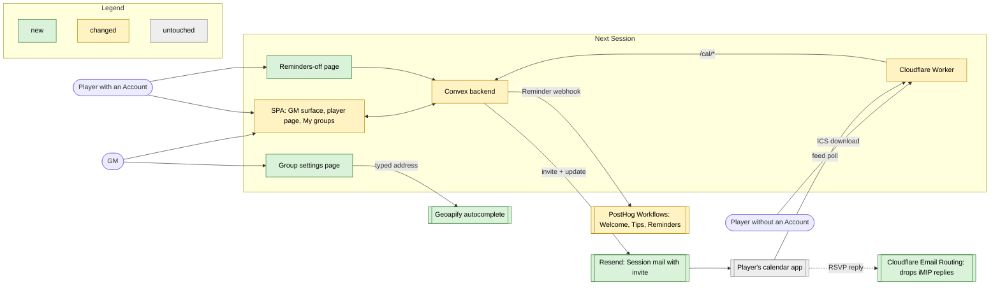
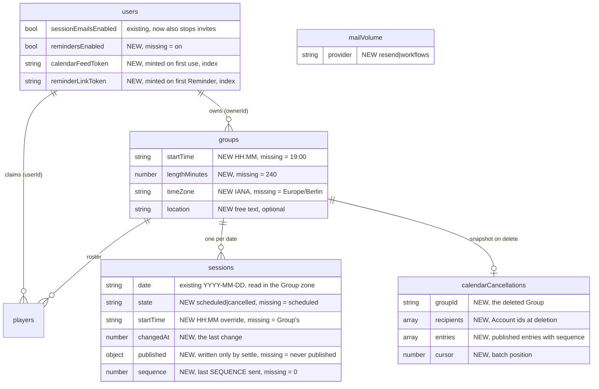
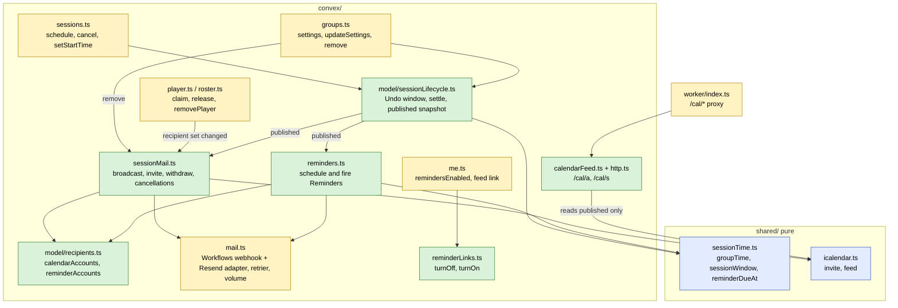
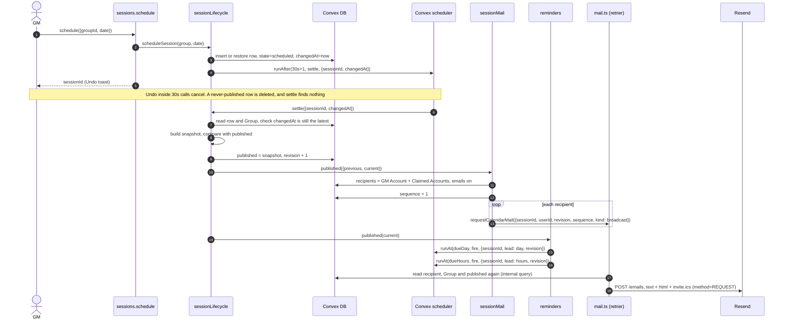
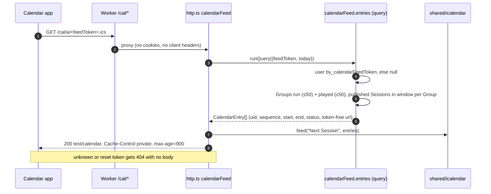
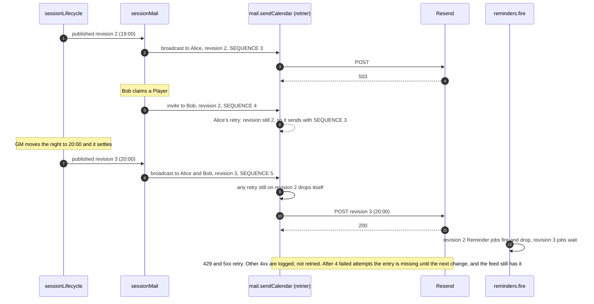
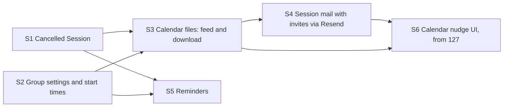

# Calendar sync: architecture

Status: **parked for Michael's review** (prototype [#126](https://github.com/Silthus/next-session/issues/126) on map [#120](https://github.com/Silthus/next-session/issues/120)). Throwaway branch `prototype/calendar-sync-architecture`, never merged. The specs that follow copy from it.

Worked AFK on recommended answers. Every call marked 🤖 is the worker's own recommendation, waiting for Michael's review. Calls marked 🔒 are already settled by a closed ticket, the code or an ADR, and the source is named next to them.

## The question

How should calendar sync be shaped across modules and the data model? It covers the start time model, the Group location, the Cancelled Session, delivery, Reminders, a stable `UID` and `SEQUENCE` per Session, how delivery hooks into `sessions.schedule` / cancel next to the Session mail and its Undo window, the ICS download, the test seams, and the spec split.

## Inputs

| Ticket | What it settled |
| --- | --- |
| [#121](https://github.com/Silthus/next-session/issues/121) | 🔒 Emailed invites (iMIP) are the push path. Beside them, a secret per-Account feed that shares its iCalendar generation with the visitor download. GM Google Calendar dropped |
| [#122](https://github.com/Silthus/next-session/issues/122) | 🔒 Workflows can't attach a `text/calendar` part. Calendar mail goes through Resend from Convex |
| [#123](https://github.com/Silthus/next-session/issues/123) | 🔒 Geoapify Free from the browser over a plain text field. Store only the string |
| [#124](https://github.com/Silthus/next-session/issues/124) | 🔒 A Session is scheduled or cancelled. **Schedule again** restores the same Session. A change inside the Undo window reaches nobody |
| [#125](https://github.com/Silthus/next-session/issues/125) | 🔒 Reminders are emails 1 day and 2 hours before the start, only to Accounts behind Claimed Players, with their own switch (default on) and a footer link. No `VALARM` anywhere. Scheduled in Convex. Workflows can send them |
| [#129](https://github.com/Silthus/next-session/issues/129) | 🔒 `METHOD:REQUEST` with the player as `ATTENDEE` lands, moves and cancels hands-free in Outlook. Gmail at "known sender" needs one tap. RSVP fails |
| Map notes | 🔒 Usual start time, time zone and length on a new Group settings page, and a Session can override its time. One location per Group. RSVP sync and travel time are out. No explicit onboarding |

Code read and checked: `convex/schema.ts:70` (`sessions` is `{groupId, date}`), `convex/sessions.ts:11` (`schedule`), `convex/sessions.ts:34` (`unschedule` hard-deletes), `convex/notifications.ts:212` (`queueSessionMail` and the `sessionMailStates` latest-change row), `convex/notifications.ts:117` (`sessionChanged` waits out the window, then `fanOut`), `convex/mail.ts:98` (`sendSession` posts to the Workflows webhook through the action retrier), `convex/mail.ts:136` (`recordMailVolume`, one counter across kinds), `convex/http.ts` (only Convex Auth routes), `convex/crons.ts` (one daily sweep), `worker/index.ts` (the `/ingest` proxy pattern), `convex/player.ts:228` and `convex/me.ts:100` (Session reads return dates only).

## RSVP live send (follow-up from #129)

One `METHOD:REQUEST` with `ATTENDEE;…;PARTSTAT=ACCEPTED;RSVP=FALSE`, sent 2026-10-16 09:28 Berlin through Resend from `hello@next-session.link`. The script is in [`rsvp-live-send/`](rsvp-live-send/). No key or address is committed.

- **Raw MIME (disposable mail.tm inbox):** the calendar part arrives as `text/calendar; charset=utf-8; method=REQUEST; name=invite.ics`, base64, and decodes to `ATTENDEE;CN=Player;ROLE=REQ-PARTICIPANT;PARTSTAT=ACCEPTED;RSVP=FALSE:mailto:<inbox>` unchanged. DKIM `d=next-session.link`, SES `eu-west-1`, as in #129.
- **Delivery:** Resend accepted all three sends to Michael's test inboxes (3 ids). The key can only send, so delivery is read in the inboxes.
- **Client rendering: Michael's to check.** Look for **"Spieleabend C · RSVP-Test"**, Sat 31.10. 19:00–23:00 Berlin, subject `[RSVP-Test 2026-10-16 accepted]`. Two questions:
  1. Does Notion Calendar (or Outlook / Gmail) still show an RSVP button, and does tapping it still fail?
  2. Does the entry show as "Going" / accepted?

  `bun --env-file ~/.config/next-session/invite-test.env docs/architecture/rsvp-live-send/send.ts accepted-cancel inboxes` removes it afterwards.
- This send still carried the 2-hour `VALARM` from #129's builder, because it went out before #125 dropped alarms. That doesn't change the RSVP result. The script no longer emits one.

---

## Round 1: Context



❓ **Q1.1 Who gets the calendar entry?** The destination says "every Account that runs a Group or keeps one". Session updates today exclude the actor.
➡️ 🤖 **The GM's Account and every Account behind a Claimed Player, the actor included.** A calendar entry is the point, not news, so the GM who scheduled the night gets it too. An Anonymous GM has no email and uses the download. Reminders stay as #125 set them: only Accounts behind Claimed Players.

❓ **Q1.2 Does the invite come on top of the Session update, or replace it?** #122 left this open. Session updates are live in Workflows (#102).
➡️ 🤖 **Replace it: one Session mail per change and Account, sent through Resend, with the Session update text as the body and the invite as its calendar part.** Two mails per change is noise, and an invite already carries a body. It also splits the two 100-a-day quotas by job: Resend carries Session mail, Workflows carries Welcome, Tips and Reminders (the largest volume, 2 per Session and Account). This reopens the ADR-0011 amendment of 2026-10-07 and needs a new ADR (see Capture). *Alternative:* keep the Workflows update and add a separate invite mail. That keeps #102's live path untouched but sends two mails for every set and cancel.

❓ **Q1.3 One sender, or one per Group?** Google advises against a generic sender (#121).
➡️ 🤖 **One sender, `Next Session <calendar@next-session.link>`, which is also the `ORGANIZER`.** #129 proved the shared sender works in Outlook. Per-Group senders cost DNS and reputation work for a hypothetical gain. `hello@` stays for Welcome Mail and Tips.

❓ **Q1.4 What happens to RSVP replies?**
➡️ 🤖 **`PARTSTAT=ACCEPTED;RSVP=FALSE` on the attendee, plus a Cloudflare Email Routing rule for `calendar@` that drops mail.** The entry arrives as accepted. Any reply a client still sends is accepted and dropped instead of bouncing, so no personal data is kept and the Privacy Policy needs no row for it. The live send above checks the first half on the wire. Client rendering waits for Michael.

❓ **Q1.5 Gmail's one tap.**
➡️ 🤖 **Absorb it with copy and the feed, not with a contacts trick.** The Session mail says "Not in your calendar yet? Tap **Add to calendar** once." My groups offers **Subscribe in your calendar app** (the Account feed), which is hands-free after one setup. The contacts entry is untested and needs the player to do more than one tap.

---

## Round 2: Data model



`published` is `{state, start, end, summary, location?, revision}`: the snapshot of the Session that calendars, Session mail and Reminders know. Only the settle job writes it. Removed: the `sessionMailStates` table. The Session row now holds its own latest change, because cancelling no longer deletes it.

❓ **Q2.1 Where do the start time, length and time zone live, and what about existing Groups?**
➡️ 🤖 **Four optional fields on `groups`, read through one pure `groupTime(group)` that fills the defaults: 19:00, 4 hours, `Europe/Berlin`.**
- Existing rows need no migration write: a missing value is the default, as #124 did for the Session state.
- New Groups capture the creator's browser zone (`Intl.DateTimeFormat().resolvedOptions().timeZone`), passed to `groups.create` and to the anonymous sign-in that creates the first Group. The server validates it.
- A GM whose existing Group isn't in Berlin changes it once on the settings page.
- The 4 hours match the live test. 19:00 is the usual game night start and is easy to change.

❓ **Q2.2 What can a Session override?**
➡️ 🤖 **Its start time only (`sessions.startTime`), with "follow the Group" as the missing value.** The length, zone and location stay the Group's. Michael asked for the time, and one override keeps the day panel to one field. A restored Session keeps its override, because it is the same row. Without an override it follows the Group's current usual time (#124 follow-up).

❓ **Q2.3 How does the Cancelled Session sit in the schema?**
➡️ 🤖 **`state` on the row, where missing means scheduled, plus `changedAt` and `published`.**
- **Cancel** deletes a row that was never published, which is only possible inside its first Undo window. It leaves no trace (#124). Any other cancel sets `state: "cancelled"`. Whether anyone hears of it is the settle job's call (Q3.1), not cancel's. So cancel → **Schedule again** → cancel inside one window, from a published scheduled Session, still announces the cancel, while cancel → Undo announces nothing.
- **Undo of a cancel** and **Schedule again** are the same call, `sessions.schedule({groupId, date})`. It restores the cancelled row by id, or inserts a new one when the row was deleted. A deleted row was never published, so a new id loses no calendar identity (#124 follow-up "Undo on a restored id").
- **Migration:** one internal mutation backfills `published` on every existing row from its current values with `revision: 0` (a few hundred rows, in pages). It runs in the same PR, before the code that reads `published`. S4's switch-on then sends the first invites for upcoming Sessions (spec split).

❓ **Q2.4 The Group location.**
➡️ 🔒 (#123, map notes) **One optional free-text `groups.location`, at most 200 characters, trimmed.** No coordinates and no provider id. It goes into `LOCATION` and the Reminder.

❓ **Q2.5 Feed and Reminder-link tokens.**
➡️ 🤖 **Two random 128-bit tokens on `users`, each with its own index, minted lazily.**
- They are credentials in the sense of ADR-0004: whoever holds one gets exactly one thing, the feed or the Reminders switch. They are separate, so a leaked feed URL can't turn off Reminders, and the other way round.
- **The Account feed carries no Share Token.** Its entries link to `next-session.link/g/<groupId>` for a Group the Account runs and to `next-session.link/me` for one it plays in, and both need sign-in. So **Reset feed link** on My groups revokes everything the leaked URL gave. It mints a new token at once, with no Undo, because a leaked feed wants a hard stop.
- A stored token, not an HMAC: one lookup, testable without a secret, revocable per Account.

---

## Round 3: Modules and seams



The deep module is **`model/sessionLifecycle.ts`**. Every change to what a Session means to the outside goes through it: schedule, cancel, restore, a time override, a Group settings edit, a rename. It owns the Undo window and the **published snapshot**. Callers say what changed, and the lifecycle decides whether anyone hears about it, and when.

Everything outside the GM's and players' own screens reads `published`, never the live row: Session mail, Reminders, the feed, the download and every retry. That is how the Undo window holds for every channel, the pull ones included.

❓ **Q3.1 Edge-triggered or level-triggered delivery?** Today `queueSessionMail` records an event (scheduled / cancelled) keyed by Group and date and checks after the window that it still holds.
➡️ 🤖 **Level-triggered, through the published snapshot.**
- The settle job runs `UNDO_WINDOW_MS` after the latest `changedAt`. Latest wins, so edits coalesce.
- It builds the snapshot the row means now (state, start, end, Group name, location). If that equals `published`, it does nothing. That is the whole Undo rule.
- Otherwise it writes `published` with `revision + 1` and hands the old and new snapshot to Session mail and Reminders.

A time edit, a Group settings edit and a rename take the same path. The settle job runs whether or not mail is configured, so `published` means "past the Undo window" in every deployment, dev and CI included.

❓ **Q3.2 What is in the snapshot, and which Sessions does a Group edit touch?**
➡️ 🤖 **State, start and end instant, Group name (`SUMMARY`) and location.** No link: invites and the feed carry token-free links (Q2.5). So a Share Token rotation sends nothing, and the new Share Link reaches players through the mail body the next time something changes.

A Group settings edit or rename queues a settle for **every** upcoming Session. A Session with its own start time still inherits the length, zone and location. Each settle's comparison decides whether that Session changed.

❓ **Q3.3 UID, SEQUENCE and stale sends.**
➡️ 🤖 **`UID` is `<sessionId>@next-session.link`, fixed for the row's life. `SEQUENCE` is `sessions.sequence`, incremented once per send round:** one broadcast after a publish, or one per-recipient invite or withdrawal.
- **Staleness is judged by `published.revision`, never by `sequence`.** Each send job carries the revision it delivers and builds its calendar part from `published` at send time. A broadcast or invite job drops itself when `published.revision` has moved on, because the newer broadcast covers its recipient. A per-recipient send that bumped `sequence` therefore never cancels anyone else's pending retry.
- The feed and the download report the current `sequence`, so they never go backwards against an invite.
- `DTSTAMP` is the send time.
- A Convex id reveals nothing, and `ownedSession` already refuses foreign ids.

❓ **Q3.4 Who follows Roster changes?**
➡️ 🤖 **Session mail does, by comparing the calendar recipient set before and after.** The set is the GM's Account plus the Accounts behind Claimed Players, deduplicated.
- A claim that adds an Account to the set queues an **invite** (`REQUEST`) for each upcoming published scheduled Session. At send time it needs the Account to be in the set.
- A release, **Remove from my groups** or the GM removing a Player, when it takes an Account out of the set, queues a **withdrawal** for each upcoming published Session. A withdrawal is a `CANCEL` to that `ATTENDEE` with no `STATUS`, as RFC 5546 §3.2.5 wants for an uninvited attendee. At send time it needs the Account to still be out of the set. So the release itself doesn't suppress it, and a GM who releases their own Player keeps their entry.
- **Deleting a Group** (by hand or by Expiry) writes one `calendarCancellations` row with the recipients and the upcoming published entries, before the children go. A self-rescheduling internal mutation then queues at most 200 `CANCEL`s with `STATUS:CANCELLED` per run, as `cleanup.sweepExpiredGroups` pages today. That stays far below Convex's 1,000 scheduled functions per mutation, and the row is deleted when the cursor reaches the end.

Without these, a player who keeps the Group after the night is set never gets the entry, and a removed player keeps a ghost entry. Reminders need nothing extra, because they resolve recipients when they fire (#125 decision 9).

❓ **Q3.5 How are Reminders scheduled?**
➡️ 🤖 **Two scheduled functions (`day`, `hours`) per published revision whose state is scheduled, each carrying `{sessionId, lead, revision}`.**
- A job sends only when `published.revision` still equals its revision and `published.state` is scheduled.
- Any move, cancel, Schedule again or Group edit that reaches people publishes a new revision, so the old pair drops itself and the new pair takes over. Nothing has to find or cancel old jobs.
- An Undo that reaches nobody publishes nothing, so the existing pair stays and no duplicate appears. A restore that is undone inside its window leaves `published` cancelled, so the old pair stays silent.
- A due time that has already passed at publish is never scheduled (#125 decision 3).
- A job that runs late because of scheduler lag still sends within 5 minutes of its due time, and skips after that. 🤖 This reads "never sent once its time has passed" as excluding seconds of lag. Say so if you want it strict.
- Recipients are resolved when the job fires: Accounts behind Claimed Players with `remindersEnabled !== false`.
- No cron.

❓ **Q3.6 Where do the feed and the download come from?**
➡️ 🤖 **Convex HTTP actions behind the Worker, on `next-session.link/cal/…`, reading `published` only.**
- `GET /cal/a/<feedToken>.ics` is the Account feed: every published Session of the Groups the Account runs or plays in, from 31 days back to the end of the Booking Window. Cancelled ones carry `STATUS:CANCELLED`, and links are token-free (Q2.5).
- `GET /cal/s/<shareToken>.ics` is the Group download for visitors: the same window for one Group, linking to the Share Link its holder already has.

Both use `icalendar.feed` and the same `UID`s as the invites, with no `ATTENDEE`, no `METHOD` and no `VALARM`. A Session inside its first Undo window isn't published yet, so it never appears in a feed.

The Share-Token URL also works as a `webcal://` subscription, and rotating the Share Token stops it, as ADR-0004 wants. The Worker proxies `/cal/` the way it proxies `/ingest/`, so the URL stays on our domain. Responses send `Cache-Control: private, max-age=900`, and unknown tokens get a plain 404.

❓ **Q3.7 Where does the Reminders footer link go?**
➡️ 🤖 **`next-session.link/reminders/off?t=<reminderLinkToken>`, a page with one button, "Turn off Reminders".** The button calls `reminderLinks.turnOff({token})`. Opening the link alone changes nothing, so mail scanners can't turn Reminders off (the reason Tips confirm on a button, ADR-0011). The page then offers "Turn them back on" and links to My groups. The Session mail footer keeps linking to the authenticated My groups switch (#102).

---

## Round 4: Call paths

### Main write: the GM schedules a night, and it is published



Each participant knows only its own part:
- `sessions.schedule` knows authorization and the Booking Window.
- The lifecycle knows the window and the snapshot.
- Session mail knows recipients and `SEQUENCE`.
- `mail.ts` knows transports, retries and volume.

The action reads the recipient and `published` again at send time, as `sendSession` does today, so a release, an opt-out or a newer revision after the fan-out still stops the mail.

### Main read: a calendar app polls the Account feed



Bounded: 100 Groups × at most about 120 dates in the window. Real Groups hold a handful of Sessions. The query reads them through an index range on `by_groupId_and_date`.

### Failure: Resend is down, a player claims, and the night moves while mail is retrying



A per-recipient send bumps `sequence` but never makes another recipient's retry look stale. Only a newer published revision does. A mail Resend accepted but timed out on can still arrive twice. The same `UID` and `SEQUENCE` make the second one a no-op in calendars.

❓ **Q4.1 What if the settle job itself fails?**
➡️ 🤖 **It is a mutation, so Convex retries it on conflicts, and it makes no external calls.** Sending happens in actions behind the retrier. If a settle never runs (a deploy bug), the row stays unpublished or on its old snapshot: the screens are right, and nobody is told. The next change settles it.

❓ **Q4.2 Unverified Password emails (map fog).**
➡️ 🤖 **No verification gate.** Session mail already goes to unverified Password Accounts since #102. A typo address could learn the Group's location, but the Share Link in the same mail already opens the whole Group. The gate would protect little and add a flow. Worth a line in the spec's risk callout.

❓ **Q4.3 Time zones in the invite.**
➡️ 🤖 **`DTSTART` and `DTEND` in UTC (`…Z`), computed in Convex from the Group's zone. No `VTIMEZONE`.** A single Session is one fixed instant, so UTC is exact, also for a night that spans a DST change. Every client shows it in the viewer's own zone. #129 proved `TZID` with a full `VTIMEZONE`, not UTC, so S4's first live send checks UTC in Outlook and Gmail. The fallback is a full transition-aware `VTIMEZONE` generated from `Intl` for the years spanned, contained in `icalendar.ts`.

❓ **Q4.4 What is a Session's date, now that it has a zone?**
➡️ 🤖 **`date` stays the plain calendar date the GM picked, read in the Group's zone.** The Booking Window and "played" stay UTC dates (invariant 8). The one edge is a Session on today's date after midnight UTC but before midnight in the Group zone, which goes read-only one evening early for zones west of UTC. Accepted, and noted in the spec.

---

## Round 5: Contracts

### `shared/sessionTime.ts` (pure)

```ts
export type ClockTime = `${number}:${number}`; // "HH:MM", 24-hour
export type GroupTime = { startTime: ClockTime; lengthMinutes: number; timeZone: string };

export const DEFAULT_GROUP_TIME: GroupTime = {
  startTime: "19:00",
  lengthMinutes: 240,
  timeZone: "Europe/Berlin",
};

export function groupTime(group: Partial<GroupTime>): GroupTime;

export type SessionWindow = { start: number; end: number }; // epoch ms

export function sessionWindow(date: IsoDate, time: GroupTime, override?: ClockTime): SessionWindow;

export type ReminderLead = "day" | "hours";
export function reminderDueAt(start: number, lead: ReminderLead): number; // start − 24 h / − 2 h

export function isClockTime(value: string): value is ClockTime;
export function isTimeZone(value: string): boolean; // Intl accepts it
```

Invariants:
- A local time that doesn't exist (the spring-forward gap) moves forward to the next valid minute. An ambiguous one (fall-back) takes the first occurrence.
- `end` is `start + lengthMinutes` in real time, so a night across a DST change keeps its length.
- `lengthMinutes` is 30 to 720, in steps of 15.
- "1 day before" is 24 hours, not the same wall clock, so a Session the night after a DST change reminds at 18:00 or 20:00 local. 🤖 Accepted, because it is simpler and rare. The spec can switch to wall-clock time if Michael prefers.

Performance: pure, `Intl.DateTimeFormat` only.

### `shared/icalendar.ts` (pure)

```ts
export type CalendarEntry = {
  uid: string; // `${sessionId}@next-session.link`
  sequence: number;
  stamp: number;
  window: SessionWindow; // written as UTC DTSTART/DTEND
  status: "CONFIRMED" | "CANCELLED";
  summary: string; // Group name
  location?: string;
  description: string;
  url: string; // token-free for Accounts, the Share Link only in the visitor download
};

export type InviteKind =
  | "request" //  METHOD:REQUEST, STATUS:CONFIRMED
  | "cancel" //   METHOD:CANCEL, STATUS:CANCELLED: the Session is off for everyone
  | "withdraw"; // METHOD:CANCEL, no STATUS: only this attendee is uninvited (RFC 5546 §3.2.5)

export function invite(message: {
  kind: InviteKind;
  organizer: string; // calendar@next-session.link
  attendee: string; // the recipient; PARTSTAT=ACCEPTED;RSVP=FALSE
  entry: CalendarEntry;
}): string;

export function feed(calendarName: string, entries: CalendarEntry[]): string;

export function calendarContentType(kind: InviteKind): string; // text/calendar; charset=utf-8; method=…
```

Invariants:
- CRLF line ends, lines folded at 75 octets, text escaped per RFC 5545.
- Times are always UTC. There is never a `VALARM`.
- `feed` carries no `METHOD` and no `ATTENDEE`.
- Output is deterministic for equal input, which allows golden tests.

Error modes: none. The backend validates its inputs first.

### `convex/model/sessionLifecycle.ts`

```ts
export const UNDO_WINDOW_MS = 30_000;

export type PublishedSession = {
  state: "scheduled" | "cancelled";
  start: number;
  end: number;
  summary: string;
  location?: string;
  revision: number;
};

/** Insert, or restore a cancelled row in place. SESSION_EXISTS when already scheduled. */
export async function scheduleSession(ctx: MutationCtx, group: Doc<"groups">, date: IsoDate): Promise<Id<"sessions">>;

/** Delete a never-published row, else mark it cancelled. Never decides who hears of it. */
export async function cancelSession(ctx: MutationCtx, session: Doc<"sessions">): Promise<void>;

export async function setSessionStart(ctx: MutationCtx, session: Doc<"sessions">, startTime: ClockTime | null): Promise<void>;

/** After groups.updateSettings or a rename: bump changedAt and queue a settle for every upcoming Session. */
export async function groupChanged(ctx: MutationCtx, group: Doc<"groups">): Promise<void>;

/** Publish the row's snapshot if it differs from `published`, then hand old and new to the channels. */
export const settle: RegisteredMutation<"internal", { sessionId: Id<"sessions">; changedAt: number }, null>;
```

Invariants:
1. Only `settle` writes `published`. Only the lifecycle writes `state` and `changedAt`.
2. Nothing outside the GM's and players' screens reads the live row. Mail, Reminders, feeds, downloads and retries read `published`.
3. `published` changes no sooner than `UNDO_WINDOW_MS` after the change that caused it.
4. A settle whose `changedAt` is no longer the row's latest does nothing.
5. A deleted row was never published.
6. `published.revision` grows by one per publish.
7. One Session per Group and date, cancelled included (invariant 3).

Error modes: the callers' existing `NOT_FOUND`, `OUT_OF_WINDOW`, `SESSION_EXISTS` and `RATE_LIMITED`.

Performance:
- A GM call costs one row write and one scheduled function.
- `groupChanged` touches at most the upcoming Sessions in the Booking Window, about 92.
- Each settle is its own mutation and schedules at most 101 sends plus 2 Reminder jobs, below the 1,000 limit.

### `convex/sessionMail.ts` and `convex/mail.ts`

```ts
// sessionMail.ts: what goes to whom
export async function sessionPublished(ctx: MutationCtx, previous: PublishedSession | undefined, session: Doc<"sessions">): Promise<void>;
export async function recipientSetChanged(ctx: MutationCtx, args: { groupId: Id<"groups">; userId: Id<"users">; before: boolean; after: boolean }): Promise<void>;
export async function groupDeleting(ctx: MutationCtx, group: Doc<"groups">): Promise<void>; // writes calendarCancellations
export const drainCancellations: RegisteredMutation<"internal", { cancellationId: Id<"calendarCancellations"> }, null>; // ≤ 200 per run

// mail.ts: transports, unchanged shape for Welcome and Tips
type CalendarSend = {
  sessionId: Id<"sessions">;
  userId: Id<"users">;
  revision: number;
  sequence: number;
  kind: "broadcast" | "invite" | "withdraw";
};
export async function requestCalendarMail(ctx: MutationCtx, send: CalendarSend): Promise<void>;
export async function requestReminder(ctx: MutationCtx, args: { sessionId: Id<"sessions">; userId: Id<"users">; lead: ReminderLead; revision: number }): Promise<void>;
export function calendarMailConfigured(): boolean; // RESEND_API_KEY set
export function remindersConfigured(): boolean; // POSTHOG_REMINDER_WEBHOOK_URL + secret set
```

Send-time rules, checked in the action's internal query on every attempt:

| Kind | Sends only when | Calendar part |
| --- | --- | --- |
| `broadcast` | `published.revision` equals the job's, and the Account is in the calendar recipient set with Session mail on | `request` for scheduled, `cancel` for cancelled |
| `invite` | the same, and `published.state` is scheduled | `request` |
| `withdraw` | the Account is **not** in the set (a re-claim makes it moot), whatever the revision | `withdraw` |
| deletion `cancel` | always, from the snapshot row, because the Group is gone | `cancel` |

Other invariants:
- The actor gets the invite, and the body copy names "you" instead of the GM.
- `.test` addresses and Anonymous GMs never get mail.
- Volume is counted per provider (`mailVolume.provider`), warning at 80 and over 100 a day each: Session mail = 1, Reminder = 1 per send, Welcome = 1, Tips = 2.

Error modes: network errors, 5xx and Resend's 429 retry (4 attempts, backoff 5 s × 4ⁿ). Other 4xx are logged and dropped. With neither env set, nothing is scheduled, and the lifecycle still publishes. Personal data stays out of telemetry events, as in §12.6.

### `convex/reminders.ts`

```ts
export async function sessionPublished(ctx: MutationCtx, session: Doc<"sessions">): Promise<void>; // schedules day + hours if still ahead and scheduled
export const fire: RegisteredMutation<"internal", { sessionId: Id<"sessions">; lead: ReminderLead; revision: number }, null>;
```

Webhook body to Workflows: `{distinct_id, product, email, group_name, date_label, start_label, location?, lead, player_url, reminders_off_url}`.

Invariants:
- A Reminder is sent only while `published.revision` equals the job's revision and `published.state` is scheduled.
- It is never sent more than 5 minutes after its due time.
- It goes only to Accounts behind Claimed Players with `remindersEnabled !== false`.
- One job is one Reminder occurrence: the revision gate leaves at most one live pair per Session.

### HTTP and public functions

| Module | Function | Kind | Args → result | Trust |
| --- | --- | --- | --- | --- |
| `groups` | `settings` | query | `{groupId}` → `{startTime, lengthMinutes, timeZone, location}` with defaults filled | GM, owner only |
| | `updateSettings` | mutation | `{groupId, startTime, lengthMinutes, timeZone, location}` → `null` | GM, owner only, `gmEdit` |
| | `create` | mutation | gains `{timeZone?}` | GM |
| `sessions` | `schedule` | mutation | unchanged args; restores a cancelled row | GM, owner only |
| | `cancel` | mutation | `{sessionId}` → `null`; replaces `unschedule` | GM, owner only |
| | `setStartTime` | mutation | `{sessionId, startTime: string \| null}` → `null` | GM, owner only |
| `me` | `notificationSettings` | query | `{}` → `{sessionEmails, reminders}` | Account |
| | `setReminders` | mutation | `{enabled}` → `null` | Account |
| | `calendarFeed` | mutation | `{}` → `{url}`; mints the token on first call | Account |
| | `resetCalendarFeed` | mutation | `{}` → `{url}` | Account |
| `reminderLinks` | `status` | query | `{token}` → `{enabled} \| null` | visitor with link |
| | `turnOff`, `turnOn` | mutation | `{token}` → `null`; unknown token `NOT_FOUND` | visitor with link, rate limit `reminderLink` per token |
| `http` | `GET /cal/a/<token>.ics` | HTTP action | Account feed | visitor with feed token |
| | `GET /cal/s/<shareToken>.ics` | HTTP action | Group download | visitor with Share Link |

Reads gain the state and the start: `schedule.month`, `player.group` and `me.groups` return `{date, state, start}` per Session instead of a bare date. `me.groups.upcomingSessions` keeps cancelled ones, marked, until their date passes (#124).

Backend.spec.md gains the new entrances, plus two invariants to witness:
- **Feed scoping.** A feed token or Share Token reaches only its own Account's or Group's published Sessions. A reset or rotated token reaches nothing, and the Account feed never reveals a Share Token.
- **Published only.** Mail, Reminders, feeds and downloads never show a change before its Undo window ends.

---

## Privacy Policy and environment

**Privacy Policy** (one version bump, in the calendar delivery spec):
- **Processor row:** Resend (Plus Five Five, Inc., USA, DPF and SCCs; sends through AWS SES `eu-west-1`), for Session mail with calendar invites.
- **Session mail row:** add the start time, the Group location and the calendar invite. Name the GM's own Account as a recipient.
- **Reminders row:** email, Group name, date, start time, location, Share Link. Contract, 6(1)(b). Stopped by the switch or the link.
- **Calendar feed row:** a secret link per Account. The calendar app fetching it sees the Sessions of your Groups. Contract, 6(1)(b).
- **Geoapify row** (from #123), in the Group settings spec: typed text and IP, only while typing in the location field.
- **No row for iMIP replies:** Email Routing drops them unread.

**Environment:**

| Name | Where | Purpose |
| --- | --- | --- |
| `RESEND_API_KEY` | Convex prod | Turns on Session mail through Resend. A sending-only key for `next-session.link` |
| `POSTHOG_REMINDER_WEBHOOK_URL` | Convex prod | Turns on Reminders. Reuses `POSTHOG_MAIL_WEBHOOK_SECRET` |
| `POSTHOG_SESSION_WEBHOOK_URL` | Convex prod | Removed after the Resend Session mail is live |
| `VITE_GEOAPIFY_KEY` | Repo variable for the build | Address autocomplete. Origin-restricted. Missing means a plain field |
| Email Routing rule `calendar@` → drop | Cloudflare zone | Accepts iMIP replies. One MX on the apex |

No new signing secret: both link tokens are stored.

---

## Test seams

| Seam | Tested through |
| --- | --- |
| `shared/sessionTime.ts` | Vitest on plain data: defaults, override, a Berlin Session on each side of both DST changes and one spanning the October change (4 real hours), the spring-forward gap, reminder due times |
| `shared/icalendar.ts` | Vitest golden files: `request`, `cancel` with `STATUS:CANCELLED`, `withdraw` without `STATUS`, a feed with a cancelled entry, UTC times, folding of a long location with umlauts, escaping, no `VALARM` anywhere, `PARTSTAT=ACCEPTED;RSVP=FALSE` |
| `sessions.*`, `groups.updateSettings` through the lifecycle | `convex-test` through `api.*` with fake timers: the #124 table (cancel inside and after the first window, Undo by id, Schedule again restores, cancel → Schedule again → cancel inside one window still publishes the cancel, cancel → Undo publishes nothing), one publish per burst of edits, a location edit republishes a Session with its own start time, a start-time edit leaves it alone |
| Session mail | `convex-test` with a fake `fetch` that records Resend payloads and decodes `invite.ics`: one mail per recipient with the GM included, `UID` stable across restore, `SEQUENCE` strictly rising per recipient, nothing before publish, a claim's invite doesn't drop another recipient's pending retry, a release's withdrawal still sends after the claim is gone, a GM releasing their own Player gets no withdrawal, a retry on an old revision drops itself, a 503 then 200 sends once, deleting a Group with 100 Accounts × 20 Sessions drains in batches |
| Reminders | `convex-test` with fake timers: both fire at their times, a move fires only the new pair, cancel → Schedule again at the same time sends one pair (not two), a restore undone inside its window sends none, opt-out and release send none, a late publish skips the passed Reminder, the payload holds no Share Token outside `player_url` |
| HTTP routes | `convex-test` `t.fetch("/cal/…")`: 200 with a parseable calendar for a valid token, 404 after a reset or rotation, another Account's Sessions never appear (feed scoping), the Account feed holds no Share Token, a Session inside its first Undo window is absent |
| `worker/index.ts` | Vitest: `calendarTarget(url)` maps `/cal/*` to the Convex site and strips cookies, like `ingestTarget` |
| Settings page, day panel time, Cancelled marks, My groups switches, the Reminders-off page | Testing Library: props in, callbacks out. The off page calls nothing on load and `turnOff` only on the press |
| Whole flow | Playwright on the local backend: set the Group time and location, schedule, cancel after the window, Schedule again, download the Group ICS and parse it. The live proof per ship ticket sends to Michael's inboxes |

---

## Spec split (dependency order)

Each spec gets its own integration branch and ship ticket, per the map. The ticket letters are suggestions for `to-tickets`.



1. **S1 Cancelled Session.** Builds `model/sessionLifecycle.ts` and the `state`, `changedAt` and `published` fields, with the backfill. `sessions.cancel` replaces `unschedule` and `session_cancelled` replaces `session_unscheduled`. The existing Workflows Session update is driven by publish, and `sessionMailStates` is dropped. Cancelled marks show on the GM, player and My groups surfaces, and **Schedule again** is added.
   - S1a: backend lifecycle and migration.
   - S1b: UI marks and Schedule again.
2. **S2 Group settings and start times.** `shared/sessionTime.ts`, the `groups` fields, `updateSettings`, `setStartTime`, the time zone captured at create, the settings page with Geoapify and its attribution, the time shown on Sessions, and the Privacy row for Geoapify. Uses the #128 prototype.
   - S2a: backend and shared.
   - S2b: settings page.
   - S2c: the per-Session time in the day panel.
3. **S3 Calendar files.** `shared/icalendar.ts`, the HTTP routes, the Worker proxy, the feed token and **Reset feed link**, the Group download on the player page and **Subscribe in your calendar app** on My groups, and the feed Privacy row. This already gives every player a working path, Gmail included, before any invite goes out.
   - S3a: builder, routes and Worker.
   - S3b: UI, placed per #127.
4. **S4 Session mail with invites.** The Resend adapter, `sequence`, recipients with the GM included, invites and withdrawals on recipient-set changes, the batched `calendarCancellations` on Group deletion, `calendar@` with Email Routing, the provider split in `mailVolume`, the Resend Privacy row, a new ADR, and the glossary updates (**Session updates** carry the invite and include the GM).
   - S4a: built disabled.
   - S4b: switch-on. Env, DNS, a one-time invite for already-scheduled upcoming Sessions (paced against the 100 a day), live proof in Michael's inboxes, then removing the Workflows Session update path.
5. **S5 Reminders.** `reminders.ts`, `remindersEnabled`, `reminderLinkToken`, the Reminders-off page, the My groups switch, the Workflows workflow and template, and the Reminders Privacy row.
   - S5a: built disabled.
   - S5b: switch-on with a live proof.

   S5 can run in parallel with S3 and S4.
6. **S6 Calendar nudge** from #127: "All set" becomes the calendar prompt, and the Keep card promises invites. It ships last, because it promises what S3 and S4 deliver.

Open for the specs, not for this architecture:
- Resend's plan and whether its quota is shared with Lonir. Check before S4b.
- iCloud / Apple Calendar is untested. Re-run #129's three steps before S4b if Apple players matter.
- The mail copy.

---

## Capture: ADRs

| Locked seam | ADR? |
| --- | --- |
| Session mail moves to Resend and carries the invite. Reminders, Welcome and Tips stay on Workflows | **Yes, ADR-0012** (draft below). It reverses the ADR-0011 amendment of 2026-10-07, it is surprising without context (two mail providers), and it trades #102's live path for one mail per change |
| The level-triggered lifecycle, with `UID` = Session id and `SEQUENCE` per Session | **Yes, ADR-0013** (draft below). Calendars hold the `UID` forever, so it is hard to reverse |
| Feed and Reminder-link tokens | No. They follow ADR-0004's pattern and are easy to rotate |
| Group time defaults and the missing-is-default reads | No. Easy to reverse |
| Reminders as scheduled functions with self-checking due times | No. Internal to one module, easy to change |

### Draft ADR-0012: Session mail goes through Resend and carries the calendar invite

Session mail (set, cancelled, moved) goes from Convex through Resend, with the Session update as the body and an iMIP invite (`METHOD:REQUEST` / `CANCEL`) as its calendar part. Reminders, the Welcome Mail and Tips stay in PostHog Workflows. PostHog Workflows can't attach a calendar part (#122), and two mails per change would be noise. Splitting by job also splits the two 100-a-day quotas, which keeps the largest volume (Reminders) away from the invites. Considered: keeping the Workflows update and sending a second mail with the invite (no change to #102's live path, double mail), and moving all mail to Resend (one provider, but Tips' double opt-in and templates move too). Consequences: Session mail copy lives in code, not in the Workflows editor. `calendar@next-session.link` is the sender and the organizer, with an Email Routing rule that drops replies. The GM's Account now gets Session mail too.

### Draft ADR-0013: Sessions publish a snapshot after the Undo window, and every outside channel reads only the snapshot

A Session row carries its live state plus a `published` snapshot (state, start, end, Group name, location, revision) and a `SEQUENCE` counter. Every change goes through one lifecycle module. It settles the row 30 seconds after its latest change and publishes a new revision only when the snapshot differs. Session mail, Reminders, the Account feed, the visitor download and every retry read only `published`, so the Undo window holds for push and pull alike. Stale work is judged by revision: an old send or Reminder job drops itself when a newer revision exists. Undo, coalesced edits, late jobs and per-recipient sends therefore need no special cases. The calendar `UID` is `<sessionId>@next-session.link` for the row's whole life. Cancel keeps the row, unless it was never published.

Considered:
- The current edge-triggered latest-change table keyed by Group and date (`sessionMailStates`). It can't hold a sequence for a deleted row, can't express time or settings edits, and gives pull channels no Undo.
- Judging staleness by `SEQUENCE`. A per-recipient invite would then silence other recipients' retries.
- A per-recipient delivery table. More exact, but more rows and more code.

Consequences:
- `sessionMailStates` goes away.
- The Session row grows `state`, `startTime`, `changedAt`, `published` and `sequence`.
- Existing rows are backfilled as published at revision 0.
