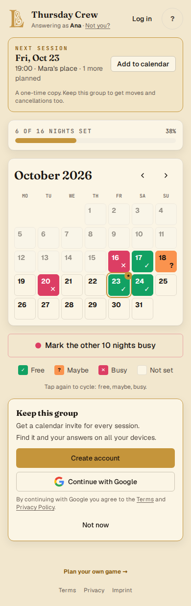
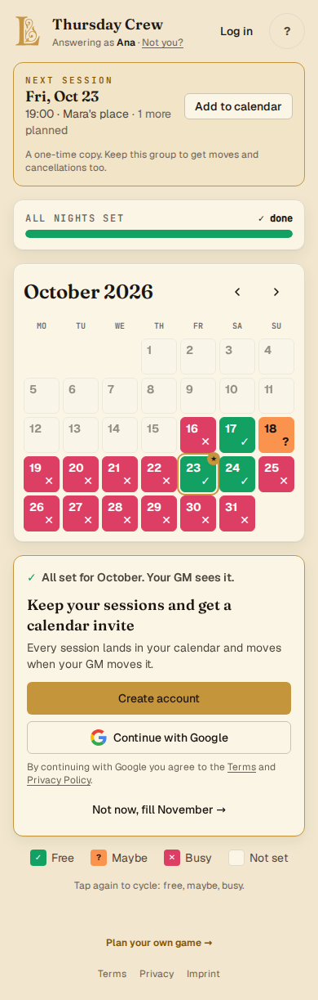
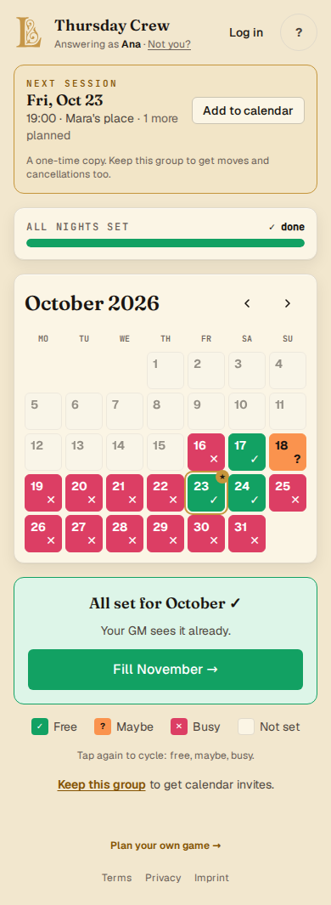
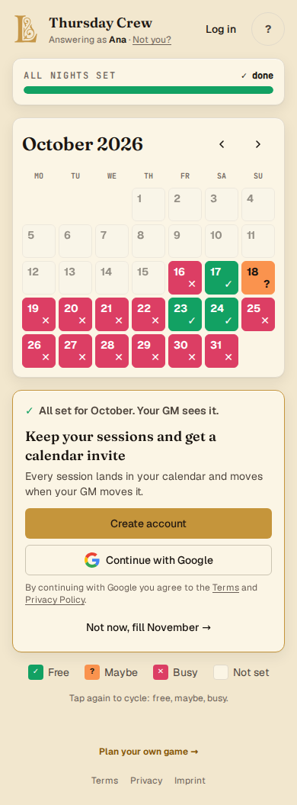
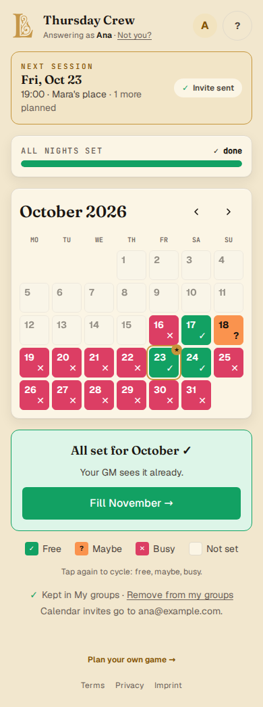

# PROTOTYPE: calendar prompt on the player page (#127)

Throwaway. Lives only on branch `prototype/calendar-prompt` and is never merged.

**Question.** What does the player page look like now that a Session can land in a calendar? Three moments: the "All set for October ✓" moment for a visitor, the Keep card from #96, and an Account that already keeps the Group. Also, where does the ICS download sit for a player without an Account?

**Mechanism assumed** (the working answer of the architecture prototype, #121 and #129): emailed `METHOD:REQUEST` invites to the Accounts behind Claimed Players, which move and cancel with the Session. Players without an Account get an ICS download, a one-time copy.

## Run it

```sh
bun install
bun run prototype          # opens /prototype/calendar-prompt on a dummy Convex URL
```

- `/prototype/calendar-prompt` shows every state side by side in 390 px frames (theme follows the OS).
- `/prototype/calendar-prompt?state=visitor-done&variant=A` shows one state full size. The floating bar cycles variants (← →) and picks the state.
- Tiles, Fill Rest, Not now and month navigation work in memory. Account buttons do nothing.
- `bun src/features/player/prototype/screenshots.ts http://127.0.0.1:5173` refreshes `screenshots/`.

The only change outside this folder: `PlayerCalendar` gained two prototype slots (`aboveProgress`, `doneCard`).

## Variants (visitor states only)

| Key | Name | The done moment | Where the pitch lives |
| --- | --- | --- | --- |
| **A** 🤖 recommended | Done becomes Keep | The green card becomes one accent card: a small "✓ All set for October. Your GM sees it." line, then "Keep your sessions and get a calendar invite". | The done card, and the Keep card while answering. |
| B | Done, then Keep | The green card stays. The Keep card with the calendar promise sits below it. | Below the done card. |
| C | Next session leads | The green card stays. | Inside the Next session strip at the top, next to the date it is about. |

## States and copy rationale

Screenshots: `screenshots/<variant>-<state>-<mobile|desktop>-<light|dark>.png`. Variant A has every state on mobile and desktop in light and dark. B and C have the visitor states on mobile in light and dark.

### `visitor-answering`: visitor, still answering



The #96 Keep card now leads with **"Get a calendar invite for every session."** and keeps "Find it and your answers on all your devices." as the second reason. It replaces "Get notified when the next session is set." because an invite is the concrete version of that promise: the date lands where the player already looks. The title stays "Keep this group", because the card is still about the Group, and the player hasn't finished answering yet.

### `visitor-done`: visitor, whole month answered



Michael's line verbatim: **"Keep your sessions and get a calendar invite"**. Under it, the mechanism in player words: "Every session lands in your calendar and moves when your GM moves it." That sentence is the reason to make an Account now and not later, and it is what `METHOD:REQUEST` with `SEQUENCE` updates delivers. The green confirmation shrinks to one line above the title, so the player still knows the answers landed. "Not now, fill November →" is the one way out, and it keeps the momentum the old card had. On the last bookable month it reads "Not now".

### `visitor-done-later`: visitor, after Not now



The old green "All set for October ✓" card comes back, so declining costs nothing. Under the legend there is one quiet line: **"Keep this group to get calendar invites."** The offer stays reachable without repeating the card.

### `visitor-nothing-scheduled`: visitor, month done, no Session yet



There is no Next session strip, so there is no download. An ICS file with nothing in it would be a dead button. The done card keeps the same copy: "every session" is a promise about the future and holds before the first one.

### The Next session strip and the ICS download (every visitor state with a Session)

The download sits with the thing it downloads. A new strip at the top of the page shows **Next session · Fri, Oct 23 · 19:00 · Mara's place · 1 more planned** and an **Add to calendar** button that downloads every upcoming scheduled Session of the Group as one `.ics` file. The line under it tells the truth and doubles as the pitch: **"A one-time copy. Keep this group to get moves and cancellations too."** The strip also answers "when do we play?" first, which the player page could only show as a ★ on a tile.

### `account-answering` and `account-done`: Account keeps the Group



The strip swaps the download for a **✓ Invite sent** chip. It says "sent", not "in your calendar", because Gmail at "known senders only" still needs one tap (#129). The kept line gains a second line, **"Calendar invites go to ana@example.com."**, so the player knows which inbox to check and can tell when it is the wrong address. The green done card stays as it is, so the invite isn't announced three times.

### `account-not-kept`: an Account that removed the Group from My groups

The same quiet line as after Not now: "Keep this group to get calendar invites." Removing the Group stops the invites, and the line says how to get them back.

## Calls made 🤖 (Michael was AFK)

1. Variant **A** for the done moment, as Michael described it. B makes two cards compete for one moment. C is the boldest and puts the pitch beside the date, but it pitches before the player has finished answering.
2. "Not now" on the done card also moves to the next month, so there is one way out, not two competing buttons.
3. The ICS download lives in a new **Next session strip** at the top, shown only when an upcoming Session exists.
4. The ICS holds **every upcoming scheduled Session** of the Group, not only the next one. Cancelled Sessions are left out.
5. The visitor download says plainly that it is a one-time copy, and that line is the pitch.
6. An Account sees "Invite sent" on the strip and "Calendar invites go to <email>" on the kept line, and nothing else changes.
7. The strip shows the Group's usual start time and location, which assumes Group settings ship first.

## Open for the spec

- Does turning off Session updates on My groups also stop calendar invites, or are they separate?
- "Moves when your GM moves it" holds in Outlook. In Gmail at "known senders only" it holds after the first tap. Is that close enough for the promise?
- An unverified Password Account: show "Invite sent" only after verification?
- Not prototyped: an Anonymous GM opening the Share Link as a player (keeps the Save-first line).
